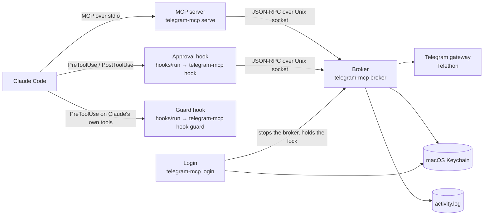
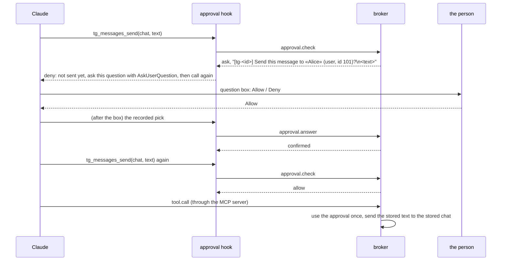

# Architecture

telegram-mcp lets Claude Code use the person's own Telegram account. Reading is free. Every
action that changes anything (in this version: sending a text message) runs only after the
person has picked **Allow** in Claude Code's question box, and each Allow runs exactly one
action.

Everything runs locally on one Mac, in one Python package.

## Components

Text version: Claude Code starts the MCP server over standard input and output, and runs the
approval hook before the send tool and after every question box. Both talk to one background
broker over a private Unix socket. The broker alone holds the Telegram connection, the
approvals and the activity log. Login runs in a terminal, stops the broker, and writes the
session to the Keychain. The guard hook runs before Claude's own shell, file, search, fetch and
subagent calls and talks to nothing.

| Component | Module | What it does |
|---|---|---|
| MCP server | `mcp_server.py` | Lists the tools, forwards each call to the broker on one kept connection, returns results as text JSON or as a tool error. Refuses every write for a client that is not Claude Code, before the broker is contacted. |
| Approval hook | `hooks.py`, `hooks/run` | `approval-pre` turns the broker's approval check into Claude Code's permission decision. `approval-post` relays the person's pick from the question box. |
| Guard hook | `guard/`, `hooks/run` | Runs before Claude's own shell, file, search, fetch and subagent calls and refuses the ones that reach the data folder, the Keychain items or the tool's own commands (below). Talks to nothing. |
| Broker | `broker/server.py` | The one process with the Telegram connection. Runs every check in a fixed order (below), holds the approvals in memory, writes the activity log. |
| Broker client | `broker/client.py` | How the other processes reach the broker: connects, starts a broker when none runs, retries once only when the request was never written. |
| Lock | `broker/lock.py` | Makes sure at most one broker (or one login) runs. |
| ConsentGate | `consent.py` | Decides which actions need confirmation, prepares the exact question, matches the pick, and lets each confirmed approval run once. |
| Tool catalog | `tools.py` | Tool declarations, closed argument schemas, validation, result shapes. |
| Telegram gateway | `gateway/` | The interface to Telegram, its Telethon implementation (the only module importing Telethon) and an in-memory fake for tests. |
| Session vault | `vault.py` | The session, `api_id` and `api_hash` in the macOS Keychain only. |
| Settings | `settings.py`, `paths.py` | Fixed paths derived from the home folder, and the two folder settings of `config.toml`. |
| Activity log | `activity_log.py` | One JSON line per call, question, decision and result; secrets redacted. |

## Files

All in `~/Library/Application Support/telegram-mcp/` (mode 0700). Every process sets its umask
to 077 first, so each file is born private.

| File | Mode | Contents |
|---|---|---|
| `broker.lock` | 0600 | `{pid, started_at, protocol, state}`; never deleted |
| `broker.secret` | 0600 | 32 random bytes as hex, new at every broker start |
| `broker.sock` | 0600 | the broker's Unix socket |
| `activity.log` | 0600 | JSON lines: `ts, client, event, tool, chat_id, approval_id, content, decision, result` |
| `broker.err` | 0600 | broker diagnostics, truncated at each start, secrets redacted |
| `config.toml` | 0600 | written by the person only: `outbox_dir`, `downloads_dir` |

The broker refuses to serve when any of them does not have its mode after it is created.

The session, `api_id` and `api_hash` are three generic-password items of the Keychain service
`telegram-mcp`. They are written together after a successful login, or not at all. Nothing is
ever stored on disk in their place.

## Login

`telegram-mcp login` asks, in the terminal only, for `api_id`, `api_hash` (hidden), the phone
number, the code, and the two-step password (hidden) when the account has one. Every typed
value is trimmed; the hidden `api_hash` also loses the terminal's bracketed-paste markers and
any other control or format character before it is checked, because the person cannot see them
at a hidden prompt.

Before asking for the code, login prints where Telegram sent it (the Telegram app, SMS, a
call, a flash or missed call, email with the masked address Telegram gives, or Fragment). When
Telegram offers no other way it says so; when it offers one it says how long to wait and that
pressing Enter with no code asks for the code that way. An empty code never counts as one of
the three tries.

## The broker protocol

JSON-RPC 2.0, one UTF-8 JSON message per line, over `broker.sock`.

Every connection starts with `hello {protocol: 1, secret, client, package_version,
client_name, client_version}`; `client` is `mcp-server`, `approval-hook` or `cli`. The secret
is compared in constant time. Any other first call, a different protocol version or a wrong
secret closes the connection.

| Method | Caller | Answer |
|---|---|---|
| `tool.call {tool, args}` | MCP server | `{ok: true, data}` or `{ok: false, error: {code, message, retry_after?}}` |
| `approval.check {tool, args}` | approval hook (pre) | `{decision: allow}`, `{decision: ask, approval_id, question, options, option_descriptions, multi_select}` or `{decision: refuse, code, message}` |
| `approval.answer {question, options, option_descriptions, multi_select, pick}` | approval hook (post) | `{outcome: confirmed \| declined \| unknown}` |
| `broker.status` | any | `{logged_in, account, clients, idle_seconds}` |
| `broker.stop` | login | `{ok: true}`, then the broker exits cleanly |

Protocol errors: -32700 parse error, -32600 invalid request, -32601 unknown method,
-32001 version mismatch, -32002 bad secret. Tool refusals are never protocol errors.

Time limits: `hello` and `approval.answer` 5 s; `approval.check` 12 s, its Telegram calls
sharing one 10 s budget; `tool.call` 75 s. Every Telegram call has its own 30 s limit, and the
Telethon client is built so it never retries or sleeps on its own.

## The approval flow

Text version: the first call is stopped by the pre hook with the exact question; the deny
reason opens with "Not sent yet: this is the confirmation step.", and the send tool's
description says up front that the first call never sends, so Claude reads the stop as a step
rather than a failure. Claude shows the question in the question box. The post hook relays the person's pick. The broker confirms the
approval only if the question text, the option labels `Allow` and `Deny` in that order, their
descriptions and single choice all equal what it prepared, and the pick is exactly `Allow`.
When Claude calls the tool again, the broker uses that confirmed approval once and sends what
was stored when the question was asked.

Rules that make this hold:

- **The arguments are bound by a digest.** The broker alone computes `sha256` of the canonical
  JSON of `{"tool", "args"}` (sorted keys, no whitespace, no floats, every default filled, the
  chat as its integer id). A call with any other argument finds no confirmed approval and gets
  `needs_confirmation`.
- **Every check runs in one order.** Connection authenticated; client allowed to write (Claude
  Code only); vault and session (`no_session`, `keychain_locked`); the tool's kind (a tool with
  no declaration counts as a write); argument validation and the digest; then either the chat
  lookup and the question (`approval.check`), or the single use of a confirmed approval and the
  Telegram call (`tool.call`). The first step that fails decides the answer, and later steps do
  not run. No Telegram call and no approval change happens without a valid session.
- **Single use.** An approval is marked used immediately before the Telegram call. A failure
  before that never uses it; a failure after it is never resent (`outcome_unknown` when it is
  not known whether Telegram got it).
- **Expiry.** An approval expires 120 s after it is prepared, whether answered or not. A sweep
  runs every 10 s and logs it.
- **Fail closed.** Any error on the approval path refuses. The pre hook denies on every
  failure, and the launcher `hooks/run` exits 2 (a block) whenever the hook cannot print a
  valid answer.
- **Memory only.** Approvals live in the broker's memory; a restarted broker forgets them.
- **At most 100 open approvals.** Past that the broker refuses until some are answered or
  expire.
- **Chat names cannot pose as text.** The chat name in the question has line breaks, control,
  format and separator characters replaced by spaces, « and » replaced by quotes, and is cut to
  64 characters. The resolved id is always shown beside it. The message text is shown in full.
- **Your own chat is named plainly.** The gateway reads the account's own id once per
  connection and marks only that chat `saved_messages`, named "Saved Messages"; its question
  reads `Send this message to your Saved Messages (id <id>)?`. A chat merely titled "Saved
  Messages" is not marked and is shown by its title and id. When the own id cannot be read, no
  chat is marked.
- **The log never holds a secret.** The broker reads the vault, and gives the redactor the
  stored session and `api_hash`, before it writes any entry carrying the caller's text, also
  for the first call after a login made while it was running.
- **Text from Telegram is marked.** Results that carry chat names or message text list those
  fields in `telegram_content_fields` with a notice that they are data, not instructions.

Plugin MCP tools are named `mcp__plugin_<plugin>_<server>__<tool>` by Claude Code; the hook
matcher is `mcp__plugin_telegram-mcp_telegram__tg_messages_send` and the hook strips the
prefix before asking the broker.

## The lock

`broker.lock` holds an exclusive `flock` for the life of the process that owns it. Its JSON
content only explains who that is: `running` (a broker), `login`, or `released`.

- A **broker** creates the file (or opens it), takes the flock without blocking, writes its pid
  and `running`, and only then touches the secret and the socket. If it cannot take the flock,
  another broker or a login won, and it exits without touching any file.
- A **caller** (MCP server, hook) never holds the lock. When it cannot connect, it tests the
  flock and releases it at once: held with `login` means `login_in_progress`; held with
  `running` means wait up to 5 s for the socket; free (no file, `released`, or the holder died)
  means start `telegram-mcp broker` in the background and wait up to 5 s.
- **Login** calls `broker.stop`, takes the flock with state `login`, and writes `released` when
  it ends, Ctrl-C included. A crashed process drops its flock with it, so the next caller finds
  the lock free.

Ten callers starting at once therefore yield one broker.

## The guard hook

Claude can run programs as the person's macOS user, so without a check its own tools could read
the activity log, talk to the broker socket with the per-start secret, read the Keychain items,
or run `telegram-mcp login` itself. The guard hook (`telegram-mcp hook guard`, through
`hooks/run`) stands in front of Claude's own tools: `Bash`, `Read`, `Write`, `Edit`,
`MultiEdit`, `NotebookEdit`, `Glob`, `Grep`, `Task`, `Agent` and `WebFetch`, with a 10 s
timeout. It never sees this plugin's MCP tools or the person's own terminal.

It **refuses**:

- **The data folder.** A file tool whose path is in `~/Library/Application Support/telegram-mcp`
  (written with `~`, relative to the working folder, through `..`, through a link, in any letter
  case); a search starting there, or a wildcard pattern that names its way in; a `file:` fetch
  of it.
- **Shell commands that reach it.** The guard reads the command the way zsh and bash do: words,
  quotes, escapes, `$'…'`, redirects, braces, `~` and variables (from the line and the
  environment), with `cd` followed within the line. It refuses a command holding the data
  folder's text or `broker.sock` / `broker.secret` in any expanded form, a word that resolves
  into the data folder, or a wildcard that names its way in. Inline scripts (`python -c`,
  `node -e`, `osascript -e`, `bash -c`, `eval`, `env -S`), substitutions, here-documents and text
  piped into a shell or interpreter get the same checks.
- **Words it cannot place.** A word holding a value the guard cannot know (an unset variable,
  the output of `$(…)`) is refused where it is used as a file, a program, a redirect or code. A
  relative word after a `cd` into such a value passes unless it holds `..` or names a file of
  the data folder.
- **The Keychain items.** `security` naming the service `telegram-mcp` or a value it cannot
  know, `dump-keychain`, `export`, an unnamed `find-generic-password` or
  `find-internet-password`, and interactive `security`; scripts naming `telegram-mcp` next to
  keyring or Keychain code.
- **The tool's own commands.** `telegram-mcp` followed by anything but `status`, `--help`, `-h`
  or `--version`, as the program or after a wrapper (`env`, `sudo`, `xargs`, `uvx`, `uv run`,
  `pipx run`, `nohup`, `time`, `nice`, `timeout`, `caffeinate`, `command`, `exec`);
  `python -m telegram_mcp…`; code importing `telegram_mcp`; the plugin's `hooks/run`. The
  person runs these in their own terminal.
- **Subagent prompts** naming the data folder or one of the refused commands.
- **What it cannot read**: a command using syntax it does not model, or that zsh and bash read
  differently (zsh parameter flags, glob qualifiers, `=cmd`, here-strings, `!` history, `case`,
  arrays, more than 256 brace results), a call that is not valid JSON or misses a field, and any
  error while deciding.

A refusal is `permissionDecision: deny` with a reason that says what was refused and what to do
instead, quoting at most 200 characters of the call. A **pass is the empty object `{}`**, never
an allow, so Claude Code's usual permission prompts still apply. When the hook cannot answer at
all, `hooks/run` exits 2 and Claude Code blocks the call. The guard reads no file, writes
nothing, and loads only the standard library and `paths.py`; a decision takes well under a
millisecond of CPU.

It is best effort. These routes are **left open on purpose**:

- Searches and copies started above the data folder (`grep -r x ~`, `find ~ -name '*.log'`,
  `cp -R ~/Library/Application\ Support …`), including a `**` that crosses it.
- The installed plugin files and Claude Code's own settings files, which could switch the hooks
  off.
- Scripts written to a file first and run later: file contents are not checked.
- A word the guard cannot place, given to a program outside its list of programs that open
  files (for example `jq`, `vim`, `git -C`).
- Text produced by a command and piped into a shell (`curl … | sh`, `(echo …) | sh`).
- A guard that times out, if Claude Code then runs the call (see the real-client checks).

When the guard blocks wrongly or cannot start (for example an empty `uv` cache with no
network), the person removes or reinstalls the plugin in their own terminal, outside Claude.

## What is not here yet

This is the first working slice: phone login, `tg_chats_list` and `tg_messages_send`, with the
guard hook above. Other tools, QR login, logout, status and log commands, idle exit and log
rotation come later. The guard covers Claude's own tools only: another program running as the
same macOS user can still read `broker.secret`. This version is for trying out, not for daily
use.
