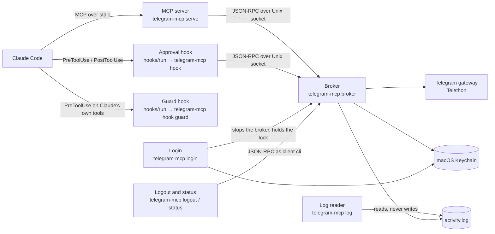
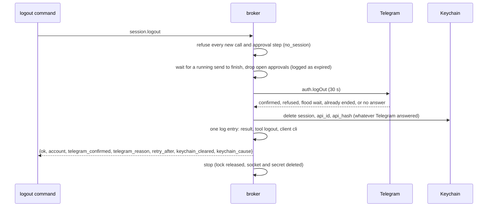
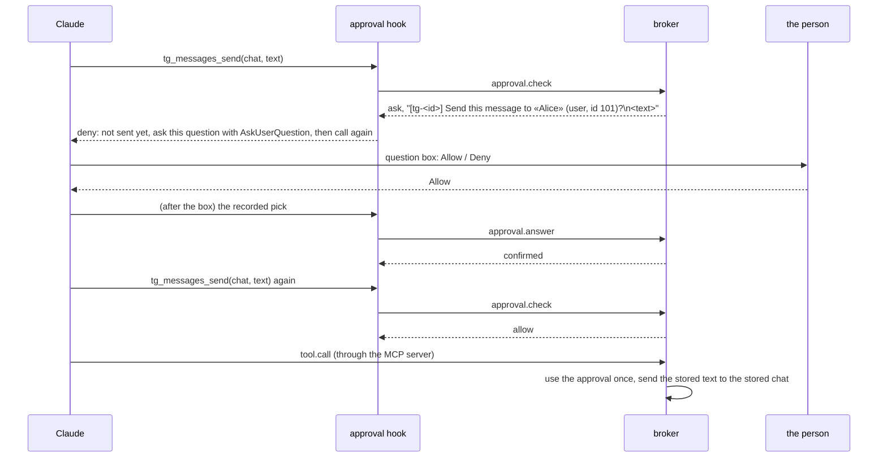

# Architecture

telegram-mcp lets Claude Code use the person's own Telegram account. Reading is free. Every
action that changes anything (in this version: sending a text message) runs only after the
person has picked **Allow** in Claude Code's question box, and each Allow runs exactly one
action.

Everything runs locally on one Mac, in one Python package.

## Components

Text version: Claude Code starts the MCP server over standard input and output, and runs the
approval hook before the send tool and after every question box. Both talk to one background
broker over a private Unix socket. The broker alone holds the Telegram connection, the
approvals and the activity log. Login runs in a terminal, stops the broker, and writes the
session to the Keychain. The guard hook runs before Claude's own shell, file, search, fetch and
subagent calls and talks to nothing. Logout and status also run in a terminal and go through the
broker like any other client. The log command reads the log files directly and touches nothing
else.

| Component | Module | What it does |
|---|---|---|
| MCP server | `mcp_server.py` | Lists the tools, forwards each call to the broker on one kept connection, returns results as text JSON or as a tool error. Refuses every write for a client that is not Claude Code, before the broker is contacted. |
| Approval hook | `hooks.py`, `hooks/run` | `approval-pre` turns the broker's approval check into Claude Code's permission decision. `approval-post` relays the person's pick from the question box. |
| Guard hook | `guard/`, `hooks/run` | Runs before Claude's own shell, file, search, fetch and subagent calls and refuses the ones that reach the data folder, the Keychain items or the tool's own commands (below). Talks to nothing. |
| Broker | `broker/server.py` | The one process with the Telegram connection. Runs every check in a fixed order (below), holds the approvals in memory, writes the activity log. |
| Telegram link | `broker/link.py` | The broker's one Telegram connection: one shared connect, back-off after failures. |
| Scheduler | `broker/scheduler.py` | The write line (one send at a time, in order) and the read places. |
| Broker secret | `broker/secret.py` | Writes the secret file whole and swaps it in one step. |
| Broker client | `broker/client.py` | How the other processes reach the broker: connects, starts a broker when none runs, retries once only when the request was never written. |
| Lock | `broker/lock.py` | Makes sure at most one broker (or one login) runs. |
| ConsentGate | `consent.py` | Decides which actions need confirmation, prepares the exact question, matches the pick, lets each confirmed approval run once, and remembers a Deny or a timeout for 60 s. |
| Question text | `prompts.py` | The closed table of action kinds and the one renderer that turns typed fields into a question and its two descriptions. |
| Action registry | `actions.py` | What the broker runs for each tool: validation, the describer that fills a question's fields, and the Telegram call. |
| Tool catalog | `tools.py` | Tool declarations, closed argument schemas, validation, result shapes. |
| Telegram gateway | `gateway/` | The interface to Telegram, its Telethon implementation (the only module importing Telethon) and an in-memory fake for tests. |
| Session vault | `vault.py` | The session, `api_id` and `api_hash` in the macOS Keychain only. |
| Settings | `settings.py`, `paths.py` | Fixed paths derived from the home folder, and the two folder settings of `config.toml`. |
| Activity log | `activity_log.py` | One JSON line per call, question, decision and result; secrets redacted. |
| Login | `login.py`, `qr.py` | Phone or QR-code login in the terminal; `qr.py` draws a login link as a QR code. |
| Logout and status | `session_commands.py` | The `logout` and `status` commands, as clients of the broker. |
| Log reader | `log_reader.py` | The `log` command: the rotated files oldest first, escaped text, `--json`, `--follow`. |

## Files

All in `~/Library/Application Support/telegram-mcp/` (mode 0700). Every process sets its umask
to 077 first, so each file is born private.

| File | Mode | Contents |
|---|---|---|
| `broker.lock` | 0600 | `{pid, started_at, protocol, state}`; never deleted |
| `broker.secret` | 0600 | 32 random bytes as hex, new at every broker start and every hour |
| `broker.sock` | 0600 | the broker's Unix socket |
| `activity.log` | 0600 | JSON lines: `ts, client, event, tool, chat_id, approval_id, content, decision, result` |
| `activity.log.1` to `.4` | 0600 | older log files, `.1` newest, `.4` oldest |
| `broker.err` | 0600 | broker diagnostics, truncated at each start, secrets redacted |
| `config.toml` | 0600 | written by the person only: `outbox_dir`, `downloads_dir` |

The broker refuses to serve when any of them does not have its mode after it is created.

The session, `api_id` and `api_hash` are three generic-password items of the Keychain service
`telegram-mcp`. They are written together after a successful login, or not at all. Nothing is
ever stored on disk in their place.

## Commands

| Command | Exit codes |
|---|---|
| `telegram-mcp login [--qr]` | 0 logged in or nothing changed; 1 failed; 2 Keychain unavailable |
| `telegram-mcp logout [--yes]` | 0 logged out, nothing to do, or declined; 1 login running, no broker or result unknown; 2 Keychain unavailable |
| `telegram-mcp status` | 0 logged in; 1 login running, Telegram unreachable or no broker; 2 not logged in or Keychain unavailable |
| `telegram-mcp log [--lines N] [--follow] [--json]` | 0; 1 bad option or unreadable file |

Each one first sets the umask to 077 and checks that it runs on macOS. Secrets are typed at
prompts only, never passed as arguments or environment variables.

## Login

`telegram-mcp login` first asks "Log in with (1) phone number or (2) QR code?"; `--qr` chooses
the QR code without asking. The question comes after the lock is taken and after any
"Replace it?" question about an account already stored.

Phone login asks, in the terminal only, for `api_id`, `api_hash` (hidden), the phone
number, the code, and the two-step password (hidden) when the account has one. Every typed
value is trimmed; the hidden `api_hash` also loses the terminal's bracketed-paste markers and
any other control or format character before it is checked, because the person cannot see them
at a hidden prompt.

Before asking for the code, login prints where Telegram sent it (the Telegram app, SMS, a
call, a flash or missed call, email with the masked address Telegram gives, or Fragment). When
Telegram offers no other way it says so; when it offers one it says how long to wait and that
pressing Enter with no code asks for the code that way. An empty code never counts as one of
the three tries.

QR login asks for `api_id` and `api_hash` the same way, then asks Telegram for a login token
and draws its `tg://login?token=…` link as a QR code in the terminal (half-block characters,
two module rows per text line, a 2-module quiet zone), with the link printed under it and
where to scan it: Telegram → Settings → Devices → Link Desktop Device on the phone. A token
lives about 30 s; an expired one is replaced by a new code automatically. Each wait for a scan
ends at the earlier of the token's expiry and a deadline 180 s after the first code, and no
new code is asked for with under 5 s left, so QR login gives up exactly three minutes after it
started. After a scan, an account with a two-step password is asked for it, three tries. The
link is a login secret: it goes to the terminal only, never to a file, the log or an error
message, and errors name only their type.

Both ways save the session exactly the same: the three Keychain items together or not at all,
and replacing a stored account restores it if a write fails. Every way out (success, failure,
Ctrl-C, end of input) disconnects from Telegram and releases the lock.

## Logout

`telegram-mcp logout` refuses while a login holds the lock, and stops with exit 2 when the
Keychain is locked. With nothing stored it deletes whatever a half-written login left, says so
and exits. Otherwise it asks the broker for status and asks "Log out of Telegram as
<account>? [y/N]" (`--yes` skips the question); only `y` or `yes` goes on.

The logout itself runs inside the broker, as `session.logout`:

Text version: from the moment the broker receives `session.logout` it refuses every new tool
call and approval step with `no_session`. A send already running finishes first and is never
interrupted. Every open approval is dropped and logged as expired. The broker then asks
Telegram to end the session within 30 s, deletes the three Keychain items whatever Telegram
answered, writes one log entry, answers, and stops. A `broker.stop` that arrives meanwhile
(a login starting) waits until the logout has answered.

The log entry's `result` is `keychain_locked` when the Keychain could not be cleared, otherwise
the Telegram reason when Telegram did not confirm (`telegram_error`, `telegram_timeout`,
`flood_wait`, `no_session` for a session already ended elsewhere), otherwise `ok`. Its
`content` is the account as name, @username and id.

The command prints one of: logged out (naming the account); this Mac is logged out but
Telegram did not confirm, with how to end the session from another device; the session had
already been ended elsewhere; or the Keychain could not delete it (exit 2). It waits at most
120 s for the answer and never sends `session.logout` twice: a lost answer is reported as
unknown, pointing to `telegram-mcp status`.

## Status

`telegram-mcp status` refuses while a login holds the lock, notes whether a broker is already
running, and connects as client `cli`, starting a broker when none runs (the same broker a
tool call would start). It waits at most 20 s for `broker.status` and retries once when the
connection drops, since status changes nothing.

The broker reads the Keychain and, with a session, asks Telegram whether it is still
authorized and who the account is, within 15 s. The answer's `session_state` is `logged_in`,
`no_session`, `ended` (the session was ended from another device; the broker forgets it),
`keychain_locked` (with `cause`) or `unreachable`. Status writes nothing to the activity log.

It prints three lines: the session state, "Background connection: running (pid N)." or
"started now (pid N).", and "Claude sessions using it: N.", counting the connections whose
hello said `mcp-server`. It exits 0 when logged in, 2 when not logged in or the Keychain is
locked, and 1 when Telegram could not be reached.

## The log command

`telegram-mcp log` reads `activity.log.4` to `.1` and then `activity.log`, oldest first,
directly from the data folder: no broker, no Keychain, no Telegram. It opens the files
read-only, reads them a line at a time (`--lines N` keeps only the last N in memory), and never
writes, creates or changes anything there.

- **Snapshot.** It opens `activity.log` first, then `.1` to `.4`, and skips a file whose inode
  it already opened, so a rotation during the read neither repeats nor drops an entry.
- **Readable lines.** `<local time>  <event>  <tool>`, then the fields present (`chat`,
  `approval`, the decision, `→ result` for result entries, `client`), then the content in full:
  after ` | ` when it is one line, otherwise on lines indented by four spaces.
- **Escaping.** Logged text came from Telegram and from the AI. Every control and format
  character, the line and paragraph separators and a lone surrogate are shown as `\xNN`,
  `\uNNNN` or `\UNNNNNNNN`, and a backslash as `\\`; only a tab is kept. Nothing logged can
  move the cursor, recolour the terminal or reverse the text.
- **`--json`.** Each valid entry is parsed and written again as one JSON line, with the same
  characters as JSON `\uNNNN` escapes, so every line parses and none carries a raw control
  character. A line that is not a valid entry prints as `(unreadable entry) …`, or as
  `{"unreadable": "…"}` with `--json`.
- **`--follow`.** After the existing entries it checks `activity.log` every 0.5 s and prints
  each new complete line; a partly written line waits for its line feed. When the file is
  rotated, it finishes the old file before starting on the new one. Ctrl-C ends it with exit 0.

## The broker protocol

JSON-RPC 2.0, one UTF-8 JSON message per line, over `broker.sock`.

Every connection starts with `hello {protocol: 1, secret, client, package_version,
client_name, client_version}`; `client` is `mcp-server`, `approval-hook` or `cli`. The secret
is compared in constant time. Any other first call, a different protocol version or a wrong
secret closes the connection.

| Method | Caller | Answer |
|---|---|---|
| `tool.call {tool, args}` | MCP server | `{ok: true, data}` or `{ok: false, error: {code, message, retry_after?}}` |
| `approval.check {tool, args}` | approval hook (pre) | `{decision: allow}`, `{decision: ask, approval_id, question, options, option_descriptions, multi_select}` or `{decision: refuse, code, message}` |
| `approval.answer {question, options, option_descriptions, multi_select, pick}` | approval hook (post) | `{outcome: confirmed \| declined \| unknown}` |
| `broker.status` | any | `{logged_in, account, clients, idle_seconds, session_state, cause, pid, mcp_clients}`: `clients` and `mcp_clients` count the Claude Code sessions connected (hook and command connections are not counted); `idle_seconds` is how long the broker had been idle before this request (see Status) |
| `broker.stop` | login | `{ok: true}`, then the broker exits cleanly (after a running logout has answered) |
| `session.logout` | logout command | `{ok, account, telegram_confirmed, telegram_reason, retry_after, keychain_cleared, keychain_cause}`, then the broker stops (see Logout) |

Protocol errors: -32700 parse error, -32600 invalid request, -32601 unknown method,
-32001 version mismatch, -32002 bad secret. Tool refusals are never protocol errors.

Time limits: `hello` and `approval.answer` 5 s; `approval.check` 12 s, its Telegram calls
sharing one 10 s budget; `tool.call` 75 s. Every Telegram call has its own 30 s limit, and the
Telethon client is built so it never retries or sleeps on its own: the broker decides who
waits (see [Sharing one connection](#sharing-one-connection)). Every `tool.call` is answered
within 70 s of reaching the broker, inside the caller's 75 s.

## The approval flow

Text version: the first call is stopped by the pre hook with the exact question; the deny
reason opens with "Not done yet: this is the confirmation step.", and the send tool's
description says up front that the first call never sends, so Claude reads the stop as a step
rather than a failure. Claude shows the question in the question box. The post hook relays the person's pick. The broker confirms the
approval only if the question text, the option labels `Allow` and `Deny` in that order, their
descriptions and single choice all equal what it prepared, and the pick is exactly `Allow`.
When Claude calls the tool again, the broker uses that confirmed approval once and sends what
was stored when the question was asked.

Rules that make this hold:

- **The arguments are bound by a digest.** The broker alone computes `sha256` of the canonical
  JSON of `{"tool", "args"}` (sorted keys, no whitespace, no floats, every default filled, the
  chat as its integer id). A call with any other argument finds no confirmed approval and gets
  `needs_confirmation`.
- **Every check runs in one order.** Connection authenticated; client allowed to write (Claude
  Code only); vault and session (`no_session`, `keychain_locked`); the tool's kind (a tool with
  no declaration counts as a write); argument validation and the digest; the Telegram
  connection; then either the chat lookup and the question (`approval.check`), or room in the
  write line, the single use of a confirmed approval and the Telegram call (`tool.call`). The first step
  that fails decides the answer, and later steps do not run. No Telegram call and no approval
  change happens without a valid session.
- **Single use.** An approval is used at the moment its write enters the write line. A refusal
  before that (not logged in, Keychain locked, Telegram unreachable, the line full, the call
  entry not logged) keeps it confirmed until it expires, so the same call works once the cause
  is gone. After that, whatever happens (dropped unsent, flood wait, timeout, sent), the
  approval is spent and the write is never made again; a new write needs a new confirmation
  (`outcome_unknown` when it is not known whether Telegram got it).
- **Expiry.** An unanswered question expires 120 s after it is prepared; an Allow must be used
  within 60 s of the pick. A sweep runs every 5 s and logs both.
- **Repeat calls.** For 60 s after a Deny or a timeout the same call is refused `declined` or
  `timed_out`; `ask_again: true` reopens the question at most twice in 10 minutes and never
  approves anything. [Confirmation rules](confirmation-rules.md) has every rule and question.
- **Fail closed.** Any error on the approval path refuses. The pre hook denies on every
  failure, and the launcher `hooks/run` exits 2 (a block) whenever the hook cannot print a
  valid answer.
- **Memory only.** Approvals live in the broker's memory; a restarted broker forgets them.
- **At most 100 open approvals.** Past that the broker refuses until some are answered or
  expire.
- **Chat names cannot pose as text.** The chat name in the question has line breaks, control,
  format and separator characters replaced by spaces, « and » replaced by quotes, and is cut to
  64 characters. The resolved id is always shown beside it. The message text is shown in full.
- **Your own chat is named plainly.** The gateway reads the account's own id once per
  connection and marks only that chat `saved_messages`, named "Saved Messages"; its question
  reads `Send this message to your Saved Messages (id <id>)?`. A chat merely titled "Saved
  Messages" is not marked and is shown by its title and id. When the own id cannot be read, no
  chat is marked.
- **The log never holds a secret.** The broker reads the vault, and gives the redactor the
  stored session and `api_hash`, before it writes any entry carrying the caller's text, also
  for the first call after a login made while it was running.
- **Text from Telegram is marked.** Results that carry chat names or message text list those
  fields in `telegram_content_fields` with a notice that they are data, not instructions.

## Actions and the question text

The broker is built with an `ActionRegistry` (`actions.py`). Each registered `ConsentAction`
has the tool's declaration (read, write or mark, and for a write its kind), a `validate`
function for its closed schema, and for a write a `describe` function and a `run` function:

- `describe(gateway, args)` reads what the question needs from Telegram (the chat, the
  messages acted on, the current value of what changes) and returns `PromptFields`. It runs
  inside the 10 s check budget; any failure refuses and prepares nothing. It never writes text.
- `render_question` (`prompts.py`) is the only place question text is made. It picks the kind's
  row in the closed table, checks the fields the kind needs, makes hidden characters visible,
  and refuses rather than cuts.
- `run(gateway, approval, args)` makes the Telegram call with the values stored on the approval.

A mark has no describer or run: the broker checks unread state with the gateway's
`unread_state`, asks, and calls `mark_read` up to the newest message counted. A read tool with
a `mark_read` option also gives `newest_returned`, so the mark never passes what it returned.

New tools plug in by registering an action; the order of the checks, the question, the
confirmation, the repeat-call memory and the log stay in the broker. The approval hook copies
the question and both descriptions from the broker's answer, so nothing in it depends on the
kind.

Plugin MCP tools are named `mcp__plugin_<plugin>_<server>__<tool>` by Claude Code; the hook
matcher is `mcp__plugin_telegram-mcp_telegram__tg_messages_send` and the hook strips the
prefix before asking the broker.

## The lock

`broker.lock` holds an exclusive `flock` for the life of the process that owns it. Its JSON
content only explains who that is: `running` (a broker), `login`, or `released`.

- A **broker** creates the file (or opens it), takes the flock without blocking, writes its pid
  and `running`, and only then touches the secret and the socket. If it cannot take the flock,
  another broker or a login won, and it exits without touching any file.
- A **caller** (MCP server, hook) never holds the lock. When it cannot connect, it tests the
  flock and releases it at once: held with `login` means `login_in_progress`; held with
  `running` means wait up to 5 s for the socket; free (no file, `released`, or the holder died)
  means start `telegram-mcp broker` in the background and wait up to 5 s. A caller that sees
  the lock turn free while it waits (a broker finishing its stop) starts a broker itself, once.
- **Login** calls `broker.stop`, takes the flock with state `login`, and writes `released` when
  it ends, Ctrl-C included. A crashed process drops its flock with it, so the next caller finds
  the lock free.

Ten callers starting at once therefore yield one broker.

## The guard hook

Claude can run programs as the person's macOS user, so without a check its own tools could read
the activity log, talk to the broker socket with the per-start secret, read the Keychain items,
or run `telegram-mcp login` itself. The guard hook (`telegram-mcp hook guard`, through
`hooks/run`) stands in front of Claude's own tools: `Bash`, `Monitor`, `Read`, `Write`, `Edit`,
`MultiEdit`, `NotebookEdit`, `Glob`, `Grep`, `Task`, `Agent` and `WebFetch`, with a 10 s
timeout. `Monitor` runs a shell command, and its command is decided exactly as `Bash`'s. The
guard never sees this plugin's MCP tools or the person's own terminal.

It **refuses**:

- **The data folder.** A file tool whose path is in `~/Library/Application Support/telegram-mcp`
  (written with `~`, relative to the working folder, through `..`, through a link, in any letter
  case); a search starting there, or a wildcard pattern that names its way in; a `file:` fetch
  of it.
- **Shell commands that reach it.** The guard reads the command the way zsh and bash do: words,
  quotes, escapes, `$'…'`, redirects, braces, `~` and variables (from the line and the
  environment), with `cd` followed within the line. It refuses a command holding the data
  folder's text or `broker.sock` / `broker.secret` in any expanded form, percent-decoded forms
  included (`file:///…/Application%20Support/telegram-mcp/…`), a word or `file:` URL that
  resolves into the data folder, or a wildcard that can match it; in a shell word a `**` may
  stand for any number of folders, the data folder among them. Inline scripts (`python -c`,
  `node -e`, `osascript -e`, `bash -c`, `eval`, `env -S`), substitutions, here-documents and text
  piped into a shell or interpreter get the same checks.
- **Links into it.** `ln`, symbolic or hard, whose source is the data folder, lies inside it, or
  is a folder holding it (such as `~/Library/Application Support`, `~` or `/`), so a link made
  now cannot be read in the same line or a later call.
- **Words it cannot place.** A word holding a value the guard cannot know (an unset variable,
  the output of `$(…)`) is refused where it is used as a file, a program, a redirect or code. A
  relative word after a `cd` into such a value passes unless it holds `..` or names a file of
  the data folder.
- **The Keychain items.** `security` naming the service `telegram-mcp` or a value it cannot
  know, `dump-keychain`, `export`, an unnamed `find-generic-password` or
  `find-internet-password`, and interactive `security`; scripts naming `telegram-mcp` next to
  keyring or Keychain code.
- **The tool's own commands.** `telegram-mcp` followed by anything but `status`, `--help`, `-h`
  or `--version`, as the program or after a wrapper (`env`, `sudo`, `xargs`, `uvx`, `uv run`,
  `pipx run`, `nohup`, `time`, `nice`, `timeout`, `caffeinate`, `command`, `exec`); after
  `xargs`, the tool with no allowed subcommand written out, since `xargs` adds words from its
  input; `python -m telegram_mcp…`; code importing `telegram_mcp`; inline code naming the tool
  and a refused subcommand, written out (`telegram-mcp log`) or as quoted words of one list or
  call (`subprocess.run(['telegram-mcp', 'login'])`); the plugin's `hooks/run`. The person runs
  these in their own terminal.
- **Subagent prompts** naming the data folder or one of the refused commands.
- **What it cannot read**: a command using syntax it does not model, or that zsh and bash read
  differently (zsh parameter flags, glob qualifiers, `=cmd`, here-strings, `!` history, `case`,
  arrays, more than 256 brace results), a text in the call longer than 64 KiB, a command whose
  expansion would take more work than the guard allows, a call that is not valid JSON or misses
  a field, and any error while deciding.

A refusal is `permissionDecision: deny` with a reason that says what was refused and what to do
instead, quoting at most 200 characters of the call. A **pass is the empty object `{}`**, never
an allow, so Claude Code's usual permission prompts still apply. When the hook cannot answer at
all, `hooks/run` exits 2 and Claude Code blocks the call. The guard reads no file, writes
nothing, and loads only the standard library and `paths.py`. An ordinary decision takes well
under a millisecond of CPU, and its work is bounded, so even a 64 KiB command is decided in a
fraction of a second.

It is best effort. These routes are **left open on purpose**:

- Searches and copies started above the data folder (`grep -r x ~`, `find ~ -name '*.log'`,
  `cp -R ~/Library/Application\ Support …`), and a `Glob` or `Grep` pattern whose `**` merely
  crosses it.
- The tool's command built from parts while code runs (`'te' + 'legram-mcp'`, a name read from
  a file or a variable set inside the script): only quoted words written out whole are seen.
- The installed plugin files and Claude Code's own settings files, which could switch the hooks
  off.
- Scripts written to a file first and run later: file contents are not checked.
- A word the guard cannot place, given to a program outside its list of programs that open
  files (for example `jq`, `vim`, `git -C`).
- Text produced by a command and piped into a shell (`curl … | sh`, `(echo …) | sh`).
- A guard that times out, if Claude Code then runs the call (see the real-client checks).

When the guard blocks wrongly or cannot start (for example an empty `uv` cache with no
network), the person removes or reinstalls the plugin in their own terminal, outside Claude.

## Sharing one connection

Two Claude Code sessions (say, the terminal and the desktop app) use the same broker and so
the same Telegram connection. The broker serves each client connection on its own and keeps
Telegram calls from starving each other:

- **One connection, one connect.** There is at most one Telegram connection. When it is not
  open, the first call that needs it starts one connect attempt as its own task; every call
  that arrives meanwhile waits for that same attempt. A caller that gives up waiting (an
  approval check at the end of its budget) never cancels the attempt for the others.
- **Back-off.** After a failed connect (no answer within 30 s, a network error), calls answer
  at once `telegram_error` "Telegram could not be reached; trying again in N s" with
  `retry_after`, for 1 s, then 2, 4, 8, 16 and at most 30 s after each further failure in a
  row. The first call after the wait tries again; a success resets the count. A call that
  times out marks the connection dropped, and the next call opens it again without restarting
  the broker. A session Telegram no longer accepts closes the connection; the next call reads
  the Keychain again.
- **The write line.** Sends run one at a time, in the order they reached the broker, from one
  line that holds at most 20 waiting sends; the 21st is refused at once ("too many sends
  waiting") with its approval kept. A send that has not started 40 s after it reached the
  broker (connect time included), or whose caller's connection has closed, leaves the line
  unsent and answers `telegram_timeout` "Not sent". With the 30 s limit on the send itself,
  every send is answered within 70 s. A send that has started runs to its end even if its
  caller has gone; its result goes to the log.
- **Read places.** Reads never use the write line. At most ten run against Telegram at once;
  the others wait for a place, and that wait counts in their 30 s limit. Approval checks,
  answers and status never wait for either.
- **Flood waits.** When Telegram asks a read to wait 30 s or less, the broker waits and runs
  the read once more, but only when the second try can still be answered within 70 s of the
  request's arrival; a second flood wait, or a longer one, returns `flood_wait` with
  `retry_after`. An approval check waits only when the wait fits in what is left of its 10 s
  budget, otherwise it refuses `flood_wait` and prepares nothing. A send never waits: it
  answers `flood_wait` at once, "nothing was sent", and needs a new confirmation.

### Idle exit

The broker stops by itself when no request has arrived or been answered for 10 minutes, even
with sessions still connected, and never while a request runs (approvals expire after 120 s,
so none is live by then). Open but silent connections, the sweep and the secret rotation are
not activity. The stop runs in this order: stop accepting connections and delete `broker.sock`
and `broker.secret`; close every client connection; disconnect from Telegram, waiting at most
2 s; then write `released` to the lock and drop it. The lock is held until Telegram is left,
so a new broker is never connected while the old one still is. A call made during the stop
waits for the lock to turn free and starts a new broker. Every stop follows this order.

### The secret every hour

Besides the new secret at each start, the broker replaces it every 60 minutes: it writes the
new value to a new file with a random name in the data folder (created exclusively, mode 0600,
no link followed) and renames it over `broker.secret`, so a reader sees the whole old secret
or the whole new one. Connections already open stay accepted; a new `hello` must carry the new
secret. A caller refused `bad_secret` reads the file again and tries `hello` once more. If the
swap fails, the old secret stays in force and the broker tries again an hour later. Temporary
secret files left by a stopped broker are deleted at start.

### Log rotation

Before an entry would take `activity.log` past 10,485,760 bytes, `activity.log.4` is deleted,
`.3` becomes `.4`, `.2` becomes `.3`, `.1` becomes `.2`, `activity.log` becomes
`activity.log.1`, and the entry starts a new `activity.log` (mode 0600). An entry is never
split between files, so reading `.4` to `.1` and then `activity.log` gives every entry in
time order. If a rename fails, the entry still goes into `activity.log` and the next entry
tries again; only an entry that cannot be appended at all refuses a send.

### What `broker.err` shows

One line each for an idle stop (with the idle minutes), a secret rotation and its failure (never
the value), the start and end of a connect back-off (failure count and wait), a send dropped
from the line (tool and approval id, never the text), and a failed log rotation.

## What is not here yet

This version has phone and QR-code login, logout, status, the log command, `tg_chats_list` and
`tg_messages_send`, with the guard hook above, a shared Telegram connection, idle exit and log
rotation. Other tools come later. The guard covers Claude's own tools only: another program
running as the same macOS user can still read `broker.secret`. This version is for trying out,
not for daily use.
